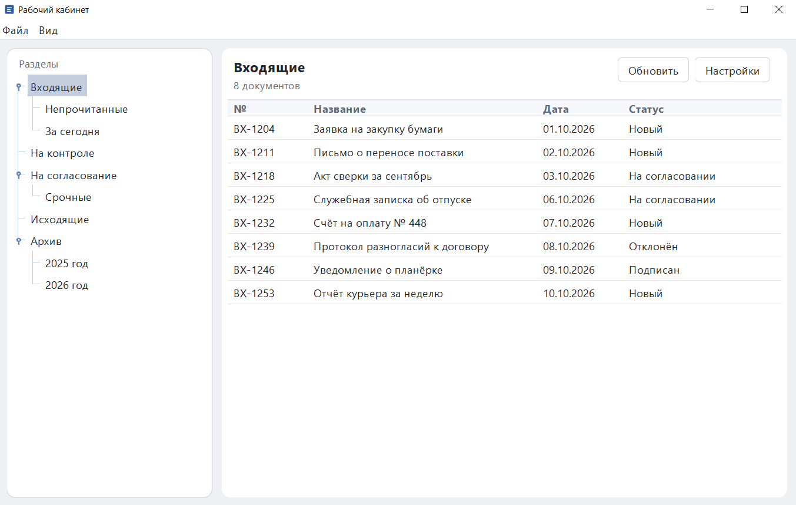
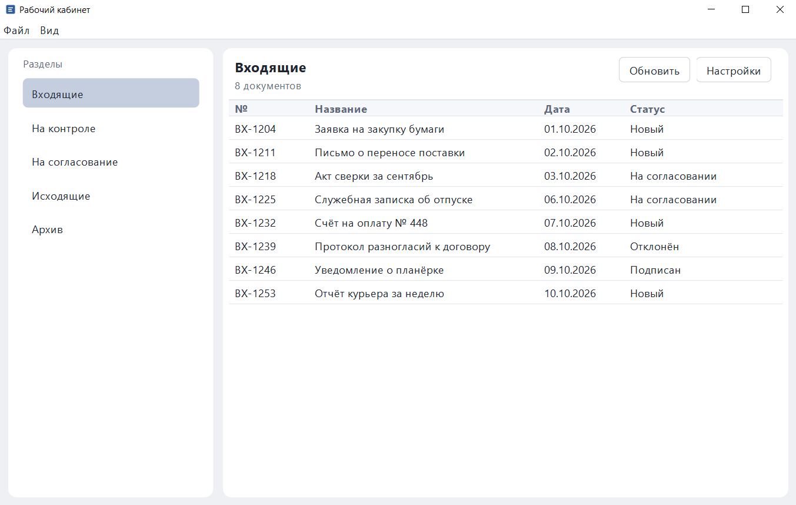
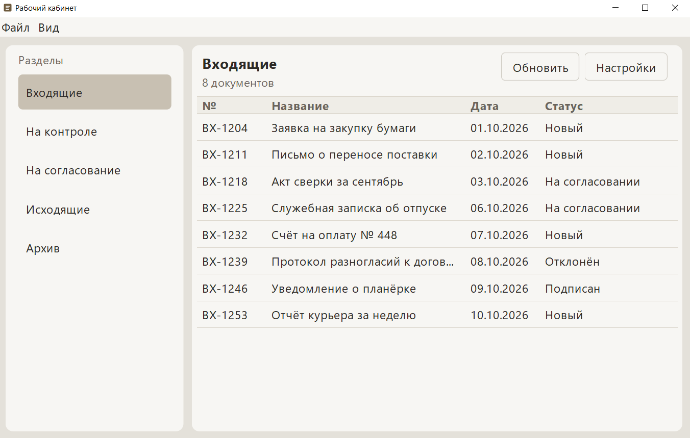

# Рабочий кабинет

Небольшое настольное приложение на Java Swing: слева разделы, справа документы выбранной папки. Можно переключить вид кабинета (дерево или панели), плотность интерфейса и тему. Настройки пишутся в локальный `user-settings.json`.

## Скриншоты

Режим дерева:



Режим панелей:



Свободная плотность и тема «Мягкий серый»:



## Требования

- JDK 17
- Maven 3.8+

Сервер, база и Spring не нужны.

## Запуск

Из корня репозитория:

```bash
mvn -q compile exec:java
```

Главный класс: `com.example.cabinet.app.Main`. Окно собирается на потоке Swing (EDT).

При первом запуске открывается режим **Дерево**, плотность **Обычная**, тема **Светлая**. Выбрана папка «Входящие». Положение разделителя по умолчанию — 280 px.

## Возможности

- клик по папке слева обновляет таблицу справа; в дереве есть один уровень вложенности
- меню **Вид** или диалог **Настройки**: режим кабинета (`Дерево` / `Панели`), плотность, тема
- в режиме панелей — плоский список со скруглённым hover, без рамки у левой карточки
- плотность меняет шрифт и высоту строк без перезапуска окна
- режим, плотность, тема и ширина разделителя сохраняются в `user-settings.json` (файл в `.gitignore`)
- **Обновить** / F5 перечитывает демонстрационные данные

## Стек и приёмы

- Swing: меню, split, таблица, диалог
- интерфейс `Cabinet` с реализациями `TreeCabinet` и `PanelCabinet`
- кастомная отрисовка: `CardPanel`, `RoundedHoverLabel`
- плотность и палитра через `UiStyle` / `UiDensity` / `ColorTheme`
- локальный JSON настроек, UI только на EDT, Maven + Java 17

## Архитектура

Кратко: левый кабинет подменяется целиком, правая таблица остаётся. Плотность и цвета приходят из одного объекта стиля. Подробности — в [docs/ARCHITECTURE.md](docs/ARCHITECTURE.md).

Пакеты:

- `com.example.cabinet.app` — вход, окно, диалог настроек
- `com.example.cabinet.ui.cabinet` — интерфейс кабинета и две реализации
- `com.example.cabinet.ui.chrome` — карточки, hover, кнопки, плотность, тема
- `com.example.cabinet.model` — папка и документ
- `com.example.cabinet.data` — демонстрационные данные в памяти
- `com.example.cabinet.settings` — модель настроек и JSON-файл

## Возможные улучшения

- иконки разделов и статусов
- загрузка демонстрационных данных из отдельного JSON, а не из кода
- карточка-календарь или предпросмотр документа
- сохранение ширины колонок таблицы

## English summary

Desktop Cabinet Demo is a small Java 17 / Swing desktop app. A split window shows folders on the left and a document table on the right. The left side can be swapped between a tree and a flat hoverable panel list without rebuilding the table. UI density (compact, normal, comfortable) and two color themes are applied through one style object and saved, with the splitter position, to a local `user-settings.json`. There is no server, database, or Spring. Run it with `mvn -q compile exec:java`. See `docs/ARCHITECTURE.md` for the cabinet interface, rounded cards, and density model.
